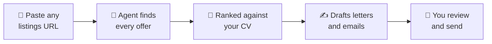
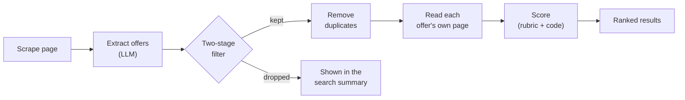
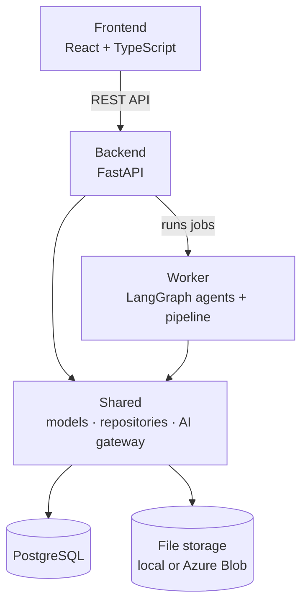
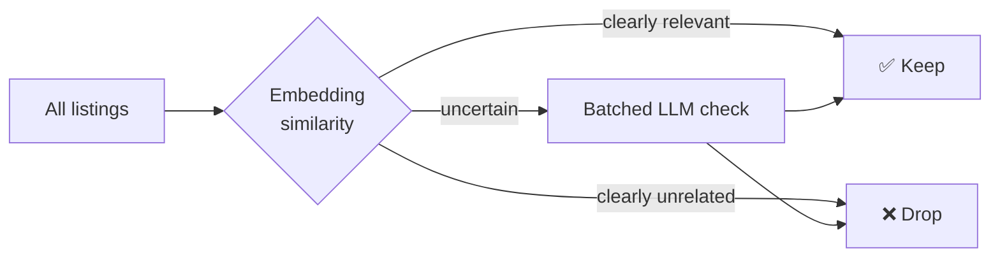
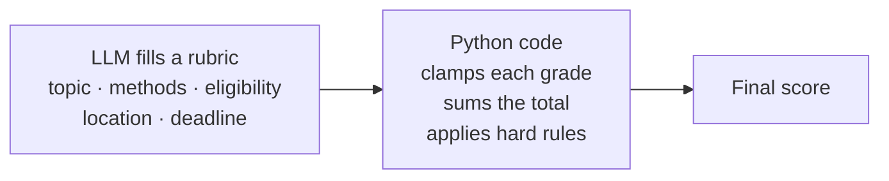
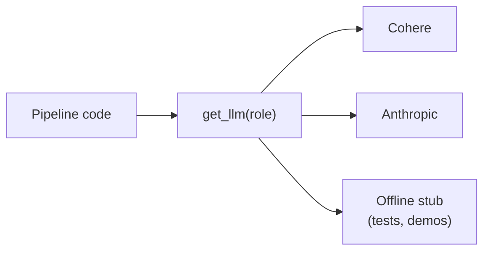
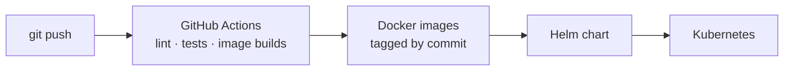

<div align="center">

# 🎓 PhD Copilot

**An AI agent platform that finds PhD opportunities, ranks them against your CV, and drafts your applications.**
*The platform does the searching. You do the deciding.*

[](https://www.python.org/)
[](https://fastapi.tiangolo.com/)
[](https://www.langchain.com/langgraph)
[](https://www.postgresql.org/)
[](https://react.dev/)
[](https://www.docker.com/)
[](https://helm.sh/)

[**▶ Watch the demo video**](https://docs.google.com/videos/d/1UKLYG_q6JOXv9U5fjIICR47r2X_nRNA4jue9ktYA7QA/play?usp=sharing)

</div>

---

## Contents

- [The problem](#the-problem)
- [Features](#features)
- [How a search works](#how-a-search-works)
- [Architecture](#architecture)
- [Key design decisions](#key-design-decisions)
- [Design patterns](#design-patterns)
- [Technical choices](#technical-choices)
- [Best practices](#best-practices)
- [Deployment and DevOps](#deployment-and-devops)
- [Tech stack](#tech-stack)
- [Run it](#run-it)
- [Project structure](#project-structure)
- [Pages](#pages)

---

## The problem

Finding a PhD means checking dozens of university websites, each with a different layout, then writing a custom cover letter for every offer, tracking deadlines in a spreadsheet, and emailing professors one by one.

**PhD Copilot turns this into: paste a link, review the results.**



The value isn't "a chatbot on top of an LLM". It's the engineering around the LLM calls that makes the results **trustworthy, cheap and safe**: scores computed by code, a cost-aware filter, safe re-runs, and humans in control of every action.

---

## Features

| Feature | What it does |
|---|---|
| **CV onboarding** | Upload your CV once; the AI extracts your research profile (areas, methods, publications, a research summary), all editable |
| **Any website** | Works on any job board or lab page: it finds the repeated listing cards from the page structure, with no site-specific scraper |
| **Smart filtering** | Removes offers that break your constraints (funding, country, degree), cheaply |
| **Fit score** | Every offer gets a score, a per-criterion breakdown and a plain-English "why it fits you" |
| **Application tracker** | Status lifecycle, deadline countdowns and a document checklist for each application |
| **Document drafting** | Cover letters, statements of purpose and research proposals, refined by chat, with version history and PDF export |
| **Professor research agent** | Studies a professor's lab and publications, finds real overlap with your work, and drafts a personal outreach email |
| **Reference requests** | Drafted emails to your referees, with status tracking and follow-up reminders |

---

## How a search works



1. **Scrape.** A LangGraph agent fetches the page. If the page is a JavaScript shell, it falls back to a headless browser. It follows pagination.
2. **Extract.** The LLM turns the page into structured listings (title, institution, deadline, funding…).
3. **Filter.** A two-stage filter drops offers that don't match your profile (see below).
4. **De-duplicate.** Offers you already have are skipped before any extra cost is spent on them.
5. **Enrich.** Each remaining offer's own page is read for the full description and the real application link.
6. **Score.** The LLM grades a fixed rubric, and the code computes the final score.

Every few pages the agent **pauses** and shows *found / kept / filtered*, so you choose to continue or stop. Crawling is never unbounded.

---

## Architecture



Three Python packages with **one-way imports**: `backend` and `worker` never import each other, and both depend only on `shared`. This rule keeps each part independent: the worker can move to its own container (with the heavy browser) without changing any code.

| Layer | Responsibility |
|---|---|
| **frontend** | The user interface; talks to the API only |
| **backend** | HTTP API, authentication, validation; starts slow work as background jobs |
| **worker** | The slow, AI-heavy work: scraping agent, filtering, scoring, research agent |
| **shared** | Database models, repositories, business rules, configuration, and the gateway for every AI call |

---

## Key design decisions

### 1. A two-stage filter to cut AI costs

Calling an LLM for every listing is expensive. A cheap embedding similarity check settles the clear cases first; only uncertain listings go to the LLM, **in batches of 20**.



**When in doubt, keep.** A wrongly dropped offer is invisible and lost forever, while a wrongly kept one only costs one extra check.

### 2. The AI grades, the code decides



The LLM never produces the final number. Code adds up the grades and applies hard caps, for example *"funding required but the offer is unfunded"* or a degree mismatch. The model can't give a high score to an offer you're not eligible for, and the scoring is a **pure function** that's unit-tested without any AI.

### 3. One gateway for every AI call



Every AI call (extracting, scoring, drafting, researching) goes through one function. Each **role** has its own model, temperature and output format in config, so a cheap model can handle the simple tasks and a strong one the hard tasks. Switching AI provider is a config change, not a code change.

### 4. Agents only where they add value

Most of the pipeline is plain, predictable code. LangGraph agents are used for **only two steps** that really need loops and decisions:

| Agent | Why it needs to be an agent |
|---|---|
| **Scraper** | Decides when to use a headless browser, retries bad extractions, follows pagination |
| **Professor researcher** | Finds the lab page, reads the publications, drafts an email, then checks its quality |

The researcher has a **quality gate**: a generic email is sent back for rewriting, **at most twice**, so it can never loop forever or run up cost.

### 5. Humans stay in control

The system **drafts**, the user **sends**. No application or email is ever sent automatically. The user reviews everything, and a malicious web page can't make the agent act on its own.

---

## Design patterns

| Pattern | Where | Why |
|---|---|---|
| **Factory + registry** | `shared/llm/factory.py` | `get_llm(role)` builds the right client from config; a new provider is one class plus one registry line |
| **Strategy** | `shared/llm/providers/` | Cohere, Anthropic and the stub are interchangeable behind one interface |
| **Template method** | `shared/llm/standard.py` | The base class implements every AI task (prompt → call → parse → validate); providers only implement "send messages" |
| **Adapter** | Provider error translation | Each SDK's exceptions become one `LLMError` type with a clear code, so callers handle one error type |
| **Repository** | `shared/repositories/` | All database access goes through small functions that always filter by user, never raw queries in routes |
| **State machine** | `shared/services/state_machine.py` | Application status changes are validated in one place, used by both the API and the worker |
| **Functional core, imperative shell** | `shared/llm/scoring.py` | Decisions live in pure functions (easy to test); I/O stays at the edges |
| **Cascade** | `worker/pipeline/ingest/prefilter.py` | Cheap check first, expensive check only when needed |
| **Evaluator–optimizer loop** | `worker/pipeline/deepdive/research_graph.py` | One step writes, another checks quality, with a bounded retry |
| **Retry with exponential backoff** | `shared/llm/retry.py` | Only temporary errors (rate limit, timeout) are retried; permanent ones fail fast |
| **Storage abstraction** | `shared/storage.py` | `save(key, data)` works on local disk in dev and on Azure Blob in the cloud; callers never know which |
| **Lazy loading** | Providers, Playwright | An SDK is imported only when that provider is used, so the app runs without optional dependencies |

---

## Technical choices

| Choice | Why | Alternative not chosen |
|---|---|---|
| **FastAPI** | Async, typed, automatic API docs, Pydantic validation | Django (heavier for an API-only backend) |
| **LangGraph** | Explicit graphs with branches and loops; easy to reason about and bound | A free-roaming agent (less predictable, costlier) |
| **PostgreSQL + Alembic** | Reliable relational data, versioned schema migrations | Automatic `create_all` at startup (untracked, collides with migrations) |
| **Pydantic Settings** | All configuration from environment variables, nested and typed | Hard-coded config or config files per environment |
| **Embeddings + LLM filter** | Cheap and recall-friendly | LLM on every listing (expensive) or keywords only (misses synonyms) |
| **Cohere and Anthropic behind one interface** | Pick the best price and quality per task, no lock-in | One provider wired into the code |
| **React + TanStack Query** | Server-state caching and background refresh with little code | Manual fetch and state handling |
| **Docker + Helm** | The same images run on a laptop, in CI and in Kubernetes | Manual server setup |

---

## Best practices

### Reliability
- **Safe to re-run.** Listings are keyed by `(user, source, source key)` and CVs by their SHA-256 hash, so a repeated search or upload never creates duplicates or extra AI cost.
- **Bounded work.** Maximum pages per search, a pause for confirmation every few pages, and a capped retry loop in the research agent.
- **Slow work as jobs.** Long operations are tracked in a `jobs` table with progress, so the UI can follow them and a page refresh never loses the run.
- **Raw pages are saved before parsing.** A prompt change can be replayed on real pages without scraping again.
- **Separate health checks.** `/api/health` tells Kubernetes "the process is alive"; `/api/ready` tells it "the database is reachable, send traffic". A database outage removes pods from traffic instead of restarting them all.

### Security
- The API **refuses to start** with a weak or default JWT secret.
- Passwords are hashed with **bcrypt**; sessions use **JWT**.
- Every query is **scoped to the current user** in the repository layer.
- Containers run as a **non-root user** with all Linux capabilities dropped.
- **No secrets in images or in git**: `.env` files are ignored, `.dockerignore` keeps them out of builds, and Kubernetes secrets are created outside the Helm chart.
- **CORS** only allows known frontend origins.
- **Upload limits** on CV files (type and size).

### Code quality
- **Typed** Python (Pydantic models, type hints) and TypeScript.
- **Linting** with Ruff in CI.
- **Unit tests** for the scoring rules, the application state machine and file storage.
- **Prompts in separate files** (`shared/llm/prompts/`), so changing a prompt never touches provider code.
- **Database migrations** versioned with Alembic, plus a bootstrap script that builds an empty database correctly.

---

## Deployment and DevOps



| Part | What's included | Why |
|---|---|---|
| **Docker** | Multi-stage, non-root images; nginx serves the frontend | Small, secure images; build tools never reach production |
| **Docker Compose** | PostgreSQL → migration → API → frontend, each waiting for the previous one to be healthy | The whole app starts with one command, in the right order |
| **Kubernetes + Helm** | One chart with separate values for dev and prod | One package for every environment, with one-command rollback |
| **Health probes** | Startup, readiness and liveness checks | Kubernetes knows when to restart a pod and when to stop sending it traffic |
| **Autoscaling** | Horizontal Pod Autoscaler on CPU, with a slow scale-down | More copies under load, without killing running work too quickly |
| **Migrations as a Helm hook** | The database is updated *before* the new version starts | New code never runs against an old schema |
| **CI/CD** | GitHub Actions: lint, tests, image builds and chart checks on every pull request; images tagged by commit | Broken code is caught before merging; every deploy is traceable to a commit |
| **Config vs secrets** | Settings in a ConfigMap, credentials in a Secret | Change settings without rebuilding; keep credentials out of git |

---

## Tech stack

| Layer | Technologies |
|---|---|
| **AI** | LangGraph, LangChain, Cohere, Anthropic, embeddings |
| **Backend** | Python 3.11, FastAPI, SQLAlchemy, Alembic, Pydantic, JWT + bcrypt |
| **Scraping** | httpx, BeautifulSoup, Playwright |
| **Frontend** | React, TypeScript, Vite, TanStack Query, Zustand |
| **Data** | PostgreSQL, local or Azure Blob file storage |
| **DevOps** | Docker, Docker Compose, Kubernetes (kind), Helm, GitHub Actions |
| **Quality** | Pytest, Ruff |

---

## Run it

**With Docker (easiest):**

```bash
cp .env.example .env      # set JWT_SECRET (32+ characters) and an LLM key, or LLM__PROVIDER=stub
docker compose up --build
```

Open **http://localhost:5173**.

**On Kubernetes (local kind cluster):**

```bash
make kind-up        # create the cluster with ingress, metrics-server and a dev database
make k8s-secret     # load secrets from .env.k8s
make helm-dev       # build the images, load them into the cluster, deploy with Helm
```

Open **http://localhost:8088**.

**For development:**

```bash
make install && make migrate
make backend        # API on :8000 (interactive docs at /docs)
make front          # frontend on :5173
```

No API key? Set `LLM__PROVIDER=stub` and the whole app runs offline with deterministic results. `make help` lists every command.

---

## Project structure

```
phd-copilot/
├── backend/      FastAPI API: routes, auth, schemas, services
├── worker/       LangGraph agents and the search pipeline
│   ├── pipeline/ ingest (scraper, filter, dedupe) · score · deepdive
│   └── tasks/    background jobs
├── shared/       Models, repositories, config, AI gateway, scoring, storage
├── frontend/     React + TypeScript app
├── migrations/   Alembic migrations + bootstrap script
├── deploy/       Helm chart and local Kubernetes (kind) setup
├── tests/        Unit tests
└── .github/      CI/CD pipelines
```

---

## Pages

| Page | What you can do |
|---|---|
| **Onboarding** | Upload your CV, review the extracted profile, set constraints (funding, countries, position type) |
| **Dashboard** | Paste a URL and watch the agent work live; see deadlines and follow-ups |
| **Opportunities** | All found offers with fit scores, a score breakdown and "why it fits you" |
| **Applications** | Track each application's status, documents and referees |
| **Documents** | Draft and refine cover letters, statements of purpose and proposals |
| **Supervisors** | Research a professor and draft an outreach email |
| **Settings** | Profile, contact details, constraints and score threshold |

---

<div align="center">

*Built for researchers who would rather do research than refresh job boards.*

</div>
