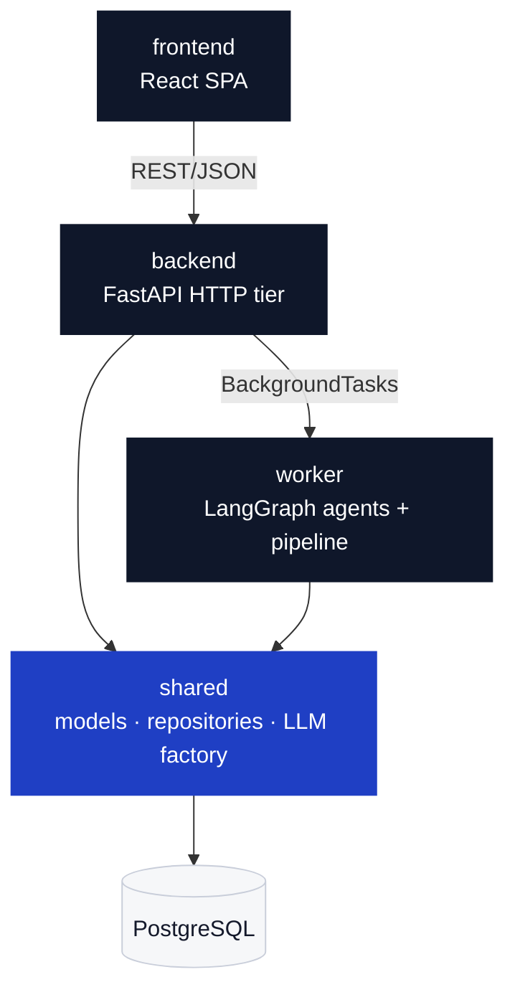
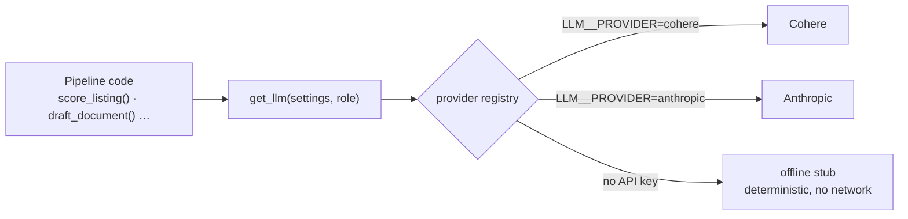
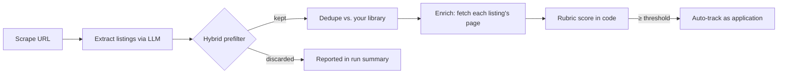

<div align="center">

# 🎓 PhD Copilot

**Agentic PhD & scholarship hunting.** The platform does the searching. You do the deciding.

[](https://www.python.org/)
[](https://fastapi.tiangolo.com/)
[](https://react.dev/)
[](https://www.langchain.com/langgraph)
[](https://www.postgresql.org/)

[**Watch the demo video**](https://docs.google.com/videos/d/1UKLYG_q6JOXv9U5fjIICR47r2X_nRNA4jue9ktYA7QA/play?usp=sharing)

</div>

---

## Why this exists

Finding a PhD or scholarship position today means manually trawling dozens of university job boards and lab pages, most of which use their own layout, then writing a bespoke cover letter for each one, tracking deadlines in a spreadsheet, and cold-emailing professors with a generic template that gets ignored.

**PhD Copilot turns that into: paste a URL, review what comes back.** It reads a listings page the way a human would (not with a site-specific scraper), scores every opportunity against *your* actual CV and constraints — not keyword matching — and drafts the documents and emails, grounded in real overlap between your work and theirs. The system never applies or sends anything on its own: it drafts, you decide.

The value isn't "an LLM wrapper" — it's the plumbing around the LLM calls that makes the results trustworthy: scores computed by code from a fixed rubric (not a raw number the model made up), a cost-aware two-tier filter so scanning hundreds of listings doesn't burn hundreds of expensive calls, and idempotent re-runs so nothing gets scored or drafted twice.

## What it does

| | |
|---|---|
| **CV-powered onboarding** | Upload a PDF once; the LLM extracts your profile — name, contact, research areas, methods, publications, a genuine research summary — editable any time. |
| **Paste any listings URL** | University job board, EURAXESS, a lab page — the discovery agent fetches it, detects repeated listing cards from DOM structure (not hardcoded selectors), follows pagination, extracts every listing. |
| **Hybrid prefilter** | An embedding pass auto-resolves the obvious keeps/discards near-free; a batched cheap-LLM pass judges the uncertain middle. Ambiguous records are always kept. |
| **Rubric scoring computed in code** | The model fills a fixed rubric; code sums it and applies hard caps (unfunded-when-required, degree mismatch). Above-threshold listings auto-track as applications. |
| **Opportunities table** | A Fit Dial per listing, a plain-English "why this fits you" paragraph, one-click live re-fetch for the full description and real application URL. |
| **Application tracker** | Controlled status lifecycle, document checklist, deadline countdowns, readiness meters. |
| **Document editor** | Drafts cover letters, statements of purpose, research proposals — chat-refined with version history, exportable to PDF. |
| **Supervisor deep-dive** | An agent researches a professor's lab and publications, finds real overlap with your work, drafts a personalised outreach email you review and send. |
| **Reference-letter requests** | Drafted emails, tracked status, automatic follow-up reminders. |

---

## Architecture

Three packages, **one-way imports**: `backend` and `worker` never import each other — both depend only on `shared`. That single rule is what turns the two-tier Docker split (lean HTTP image vs. Playwright-heavy worker image) into a deployment change instead of a refactor.



### Pattern 1 — the LLM factory: every model call behind one seam

Every LLM call in the codebase — scoring, drafting, extraction, deep-dive research — goes through a single function, `get_llm(settings, role)`. The caller never touches an SDK directly.



A **role** (`extractor`, `scorer`, `drafter`, `refiner`, `researcher`…) carries its own model, temperature, and JSON-mode setting in config — so tuning one step's model, or swapping providers entirely, is a `.env` change, never a code change. Every provider translates its own SDK exceptions into one `LLMError` type, so pipeline code catches one thing, not one per SDK, and the whole app runs with zero API keys against a deterministic stub — useful for demos, tests, and CI.

### Pattern 2 — pipeline-first, agent-second

The discovery pipeline is deliberately a **plain sequence** everywhere a real decision loop isn't needed. LangGraph (real branching + retries) is reserved for exactly two steps that actually require it: the universal scraper (escalates HTTP → headless browser, follows pagination, retries malformed extraction) and the deep-dive researcher (loops until it finds a genuine, non-generic overlap with your work).



### Other decisions worth knowing about

| Decision | Why it matters |
|---|---|
| **Rubric scoring computed in code, not by the LLM** | The model only fills a fixed rubric (topic/methods/eligibility/location/deadline); code sums it and applies hard caps. A model can't invent a 95 for a listing that fails a hard constraint. |
| **Idempotent by construction** | Listings keyed by `(user_id, source, source_key)`; CVs keyed by SHA-256. Re-running a search or re-uploading the same file is always safe, never duplicated or re-billed. |
| **Jobs table for anything slow** | Any operation over ~500ms is a row in `jobs` with server-side resumable state — a page refresh mid-run never loses progress. |
| **One state machine, enforced once** | Application status (`SAVED → IN_PROGRESS → DOCS_READY → APPLIED → INTERVIEW → OFFER`, plus `REJECTED`/`WITHDRAWN`/`EXPIRED`) is checked in exactly one place (`shared/services/state_machine.py`) — the API and the worker's auto-transitions both call through it, so they can never disagree about a legal move. |
| **Human sends, the system only drafts** | Cover letters, outreach emails, reference requests are always reviewed and sent by the user. No auto-apply, no auto-email — ever. |
| **Store raw, parse later** | Scraped pages are saved to disk before parsing, so a prompt/parser change can replay against real data without re-scraping the web. |

---

## Tech stack

| Layer | Stack |
|---|---|
| **Frontend** | React + TypeScript, Vite, TanStack Query, Zustand |
| **Backend** | FastAPI, SQLAlchemy, Alembic, JWT (bcrypt) auth |
| **Worker** | LangGraph agents, Playwright, BeautifulSoup |
| **Data** | PostgreSQL (hosted, e.g. Supabase, or local) |
| **LLM** | Cohere / Anthropic behind a role-based factory, deterministic offline stub when no key is set |
| **Ops** | Docker Compose, Poetry, Alembic migrations |

---

## How to run it

### Requirements

- Python 3.11+, Poetry 1.8+
- Node 18+ (frontend)
- A PostgreSQL database URL (hosted, e.g. Supabase, or local) — no Docker required for development
- `make` is optional — every task has a direct command below

### Quick start

```bash
make install                 # or: poetry install
cp .env.example .env
```

Edit `.env` and set at minimum:

| Variable | Notes |
|---|---|
| `JWT_SECRET` | Required. The API refuses to start if missing, default, or shorter than 32 characters. |
| `DATABASE_URL` | PostgreSQL connection string. |
| `COHERE_API_KEY` or `ANTHROPIC_API_KEY` | Plus `LLM__PROVIDER=cohere` or `anthropic`. The stub provider runs offline with no key. |
| `EMBEDDING__PROVIDER` | `cohere` enables the embedding prefilter pass; `stub` disables it safely. |

> Auth is email/password only — no Google/OAuth. Reference-request and supervisor-outreach emails send via a single shared SMTP relay account (`SMTP__*`) with Reply-To set to the sending user's own contact email; "Copy email" is always available as a fallback.

Then:

```bash
make migrate                 # or: poetry run alembic upgrade head
make backend                 # or: poetry run uvicorn app.main:app --reload   (FastAPI on :8000, /docs is Swagger)
```

In a second terminal:

```bash
make front                   # or: cd frontend && npm install && npm run dev  (Vite on :5173, proxies /api to :8000)
```

Open **http://localhost:5173**. `make help` lists every task.

For live scraping of JS-heavy sites, install the Playwright browser once:

```bash
poetry run playwright install chromium
```

Without it the scraper still works on plain-HTML pages and degrades gracefully elsewhere.

### Docker (production-shaped)

```bash
docker compose up --build
# backend  -> http://localhost:8000
# frontend -> http://localhost:5173
```

Postgres isn't a compose service — `DATABASE_URL` in `.env` points at a hosted database (e.g. Supabase) or a local instance you run yourself. The `worker` container is declared in `docker-compose.yml` but gated behind `--profile worker` and not started by default; `BackgroundTasks` in the backend drives the pipeline for now.

### Database and migrations

PostgreSQL is the supported runtime. Alembic is the source of truth for schema changes:

```bash
# After editing any model in shared/models/
poetry run alembic revision --autogenerate -m "describe the change"
poetry run alembic upgrade head
```

`migrations/env.py` reads `DATABASE_URL` from `shared.config.get_settings()` — no second source of truth. The `versions/` folder is committed. SQLite still works for ad-hoc tests via `DATABASE_URL=sqlite:///./local.db`, but it is not a supported production runtime.

### LLM providers

The whole codebase runs without an API key (`LLM__PROVIDER=stub`). Switch providers in `.env`:

```env
LLM__PROVIDER=cohere            # or anthropic
COHERE_API_KEY=...              # or ANTHROPIC_API_KEY / LLM__API_KEY
```

Per-role model and temperature overrides:

```env
LLM__ROLE_MODELS__SCORER=command-r-08-2024
LLM__ROLE_MODELS__EXTRACTOR=command-a-03-2025
LLM__TEMPERATURE_DRAFTER=0.3
```

Transient failures (rate limits, timeouts) retry with exponential backoff before falling back to the stub.

### Useful commands

```bash
make install                       # poetry install
make backend                       # dev backend (FastAPI on :8000)
make front                         # dev frontend (Vite on :5173)
make migrate                       # alembic upgrade head
make migrate-new MSG="add X col"   # autogenerate a new migration
make db-reset                      # downgrade to base then upgrade (DESTRUCTIVE)
make lint                          # ruff check
make test                          # pytest
make clean                         # remove caches + local storage
make docker-up                     # docker compose up --build
make docker-down                   # docker compose down
```

If you do not have `make` on Windows: install it via Chocolatey (`choco install make`), use WSL, or run the underlying `poetry run ...` commands directly.

---

## Layout

```
phd-copilot/
  shared/                  contracts used by both other packages
    config.py database.py models/ repositories/ services/
    llm/ (providers, prompts, retry, json extraction) embedding/ cv/

  backend/                 HTTP tier (lean image, no Playwright)
    app/  main.py auth/ routers/ schemas/ services/

  worker/                  slow-work tier (Playwright + LangGraph image)
    pipeline/  ingest/ (scraper graph, prefilter, dedupe, detail fetch)
               parse/ score/ deepdive/
    tasks/     run_pipeline.py deep_dive.py

  frontend/                Vite + React + TS SPA ("Ink & Porcelain" design system)

  migrations/              Alembic env + versions
  docker-compose.yml  pyproject.toml  alembic.ini  .env.example
```

Import direction is one-way: `backend` and `worker` never import each other; both import from `shared`.

---

## Pages & functionality

<details>
<summary><strong>Login / Register</strong> — <code>/login</code>, <code>/register</code></summary>

Email + password auth, JWT-based sessions. New accounts are routed to onboarding; returning users land on the dashboard.
</details>

<details>
<summary><strong>Onboarding</strong> — <code>/onboarding</code> (three steps)</summary>

1. **Upload CV** — drop a PDF; the LLM extracts full name, contact email, phone, research areas, methods, programming languages, degree subject, graduation year, career stage, spoken languages, publications, and a genuine 4–6 sentence research summary grounded in the CV text.
2. **Review profile** — every extracted field is editable before saving; nothing is stored without confirmation.
3. **Preferences & constraints** — funding required (yes/no/preferred), countries, start-date window, position type (PhD/postdoc/both), free-text hard constraints. These drive the prefilter and scorer on every search.
</details>

<details>
<summary><strong>Home</strong> — <code>/dashboard</code></summary>

- **Search zone** — paste any listings URL and hit Search. A live **agent console** shows a step timeline with per-step details, an elapsed clock, and an animated progress bar.
- **Pagination checkpoints** — every few pages the agent pauses and reports *found / kept / filtered*. **Continue searching** or **Stop and show results** — stopping finalizes everything found so far.
- **Search summary** — counts, why the run stopped, which listings were filtered out and why.
- **Needs attention** / **Follow-ups** — approaching deadlines, drafts, overdue reference requests.
- **Stats cards** and **recent searches** for one-click re-runs.
</details>

<details>
<summary><strong>Opportunities</strong> — <code>/opportunities</code></summary>

Every scraped-and-kept listing in one table: title, institution, location, field, funding, deadline countdown, **Fit Dial** score. The detail panel adds a per-dimension score breakdown, a "why this fits you" paragraph, live re-fetch for the full description and real application URL, and shortcuts to save/apply/research the supervisor.
</details>

<details>
<summary><strong>Applications</strong> — <code>/applications</code>, <code>/applications/:id</code></summary>

Kanban-grade tracker with the controlled status lifecycle shown above, enforced by the state machine. Each detail view has a docs checklist, reference-request flow (draft → refine by chat → send or copy → track follow-ups), notes, priority, and deadline fields.
</details>

<details>
<summary><strong>Documents</strong> — <code>/documents</code></summary>

Drafting workspace for cover letters, statements of purpose, and research proposals. The agent drafts from your profile + the specific listing; refine by chatting or edit directly. Full version history, author notes, warnings when a draft references things not in your CV, PDF export.
</details>

<details>
<summary><strong>Supervisors</strong> — <code>/supervisors</code></summary>

The deep-dive outreach agent. Give it a professor's name: it finds the lab page, verifies it belongs to that professor, extracts research topics and publications, identifies concrete overlap with your work, and drafts a personalised outreach email — with a quality gate that rejects and retries generic drafts. Refine by chatting, then send or copy.
</details>

<details>
<summary><strong>Settings</strong> — <code>/settings</code></summary>

Research profile (name, summary, interests, CV re-upload), contact details, search constraints, scoring threshold, and a profile-completeness checklist.
</details>

---

<div align="center">

*Built for the researcher who'd rather be doing research than refreshing job boards.*

</div>
